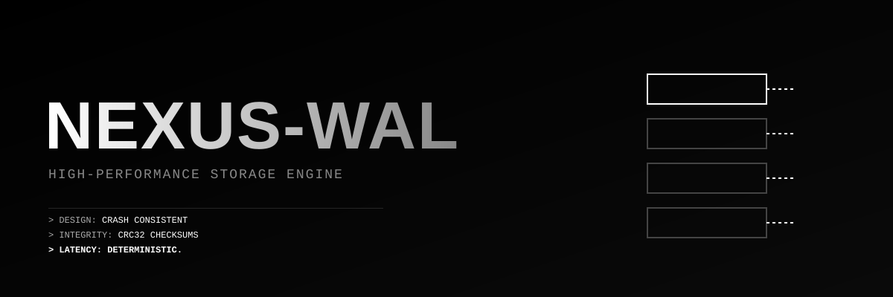

<div align="center">
  
  
  <h1>NEXUS-WAL</h1>
  <p><b>ZERO-DEPENDENCY WRITE-AHEAD LOG ENGINE.</b></p>
  
  
  
  
</div>

---

## 🏗️ WHAT IS NEXUS-WAL?

Every robust database, distributed system, and message broker relies on a Write-Ahead Log (WAL) to guarantee data durability. Before data is applied to the main storage engine, it is appended to a WAL. If the system crashes, the WAL is replayed to restore the system to a consistent state.

**NEXUS-WAL is a small pure Rust append-only log.**

It is not a database. Each append writes a length-prefixed record, a CRC32, and calls `sync_data`. Recovery stops on a checksum mismatch and ignores a truncated tail.

## ⚡ ARCHITECTURAL PRINCIPLES

*   **Append:** Each record is a little-endian length prefix, the key, the value, and a CRC32 of those bytes. `append` writes that record and then calls `sync_data`.
*   **Recovery:** The file is read and decoded record by record. A CRC mismatch stops recovery and is not returned as a record. A truncated tail is not returned as a record.
*   **Not a database:** This does not sync the directory entry, and it does not turn a process crash into a proven durability guarantee beyond `sync_data` returning. It is not production-ready storage.
*   **Zero Dependencies:** Pure `std`. No external crates for hashing, I/O, or serialization.

## 🛠️ DEPLOYMENT

> ⚠️ **NOTICE:** This is a low-level storage component intended for systems engineers building custom state machines or databases.

```bash
# 1. Clone the repository
git clone https://github.com/vantacorehq/nexus-wal.git
cd nexus-wal

# 2. Build the engine
cargo build --release

# 3. Execute the simulation
./target/release/nexus-wal

[NEXUS-WAL] Initializing storage engine...
[NEXUS-WAL] Appending records...
[NEXUS-WAL] Records written and synced to disk.

--- Simulating System Crash and Restart ---

[NEXUS-WAL] Recovering log: nexus_data.wal
  -> Recovered: [user:1001] = balance: 5000
  -> Recovered: [user:1002] = balance: 1200
  -> Recovered: [config:network] = mainnet
[NEXUS-WAL] Recovery complete. Total records: 3
