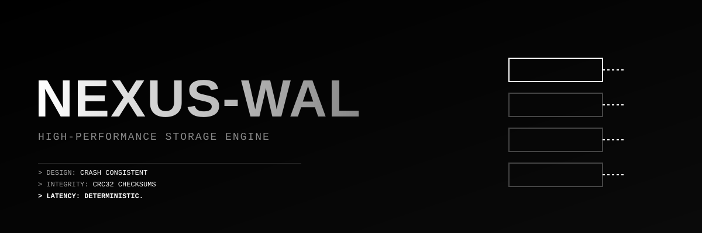

<div align="center">
  
  
  <h1>NEXUS-WAL</h1>
  <p><b>ZERO-DEPENDENCY WRITE-AHEAD LOG ENGINE.</b></p>
  
  
  
  
</div>

---

## 🏗️ WHAT IS NEXUS-WAL?

Every robust database, distributed system, and message broker relies on a Write-Ahead Log (WAL) to guarantee data durability. Before data is applied to the main storage engine, it is appended to a WAL. If the system crashes, the WAL is replayed to restore the system to a consistent state.

**NEXUS-WAL is a pure Rust implementation of this core architectural component.**

It is not a database. It is the engine that makes databases survive power outages. It handles sequential writes, computes CRC32 checksums for data integrity, and executes `fsync` syscalls to ensure data hits the physical disk.

## ⚡ ARCHITECTURAL PRINCIPLES

*   **Crash Consistency:** Data is synced to the disk (`sync_data`) immediately upon writing. No data loss on unexpected shutdown.
*   **Zero-Copy Recovery:** The recovery process streams data from disk, validating checksums in real-time.
*   **Data Integrity:** Every record is protected by a CRC32 checksum. Corrupted records are detected and isolated instantly.
*   **Zero Dependencies:** Pure `std` implementation. No external crates for hashing, I/O, or serialization.

## 🛠️ DEPLOYMENT

> ⚠️ **NOTICE:** This is a low-level storage component intended for systems engineers building custom state machines or databases.

```bash
# 1. Clone the repository
git clone https://github.com/vantacorehq/nexus-wal.git
cd nexus-wal

# 2. Build the engine
cargo build --release

# 3. Execute the simulation
./target/release/nexus-wal

[NEXUS-WAL] Initializing storage engine...
[NEXUS-WAL] Appending records...
[NEXUS-WAL] Records written and synced to disk.

--- Simulating System Crash and Restart ---

[NEXUS-WAL] Recovering log: nexus_data.wal
  -> Recovered: [user:1001] = balance: 5000
  -> Recovered: [user:1002] = balance: 1200
  -> Recovered: [config:network] = mainnet
[NEXUS-WAL] Recovery complete. Total records: 3
